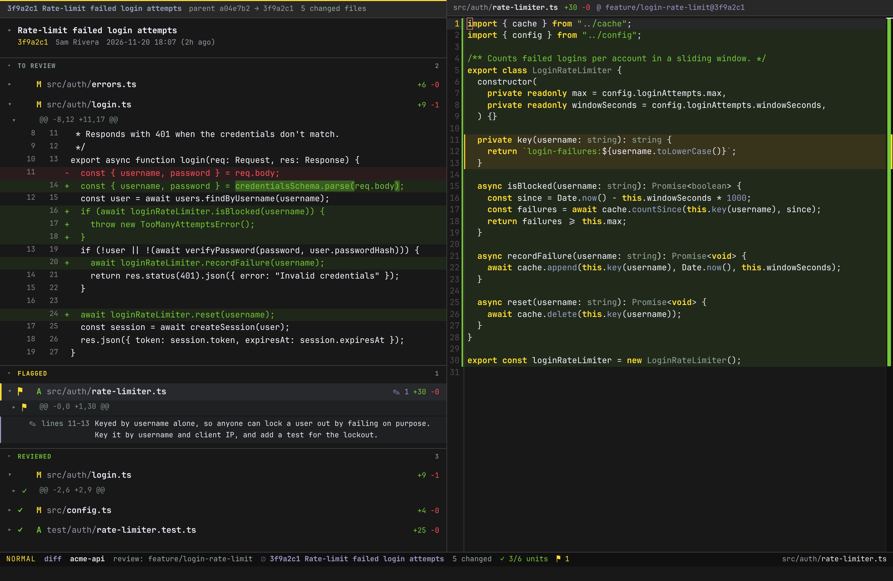

<p align="center">
  
</p>

<h1 align="center">review-me</h1>

<p align="center">
  <strong>Keyboard-driven code review for changes written by AI agents.</strong>
</p>

<p align="center">
  <a href="https://github.com/mauricio-ms/review-me/actions/workflows/ci.yml"></a>
  <a href="https://github.com/mauricio-ms/review-me/releases/latest"></a>
  
  <a href="LICENSE"></a>
</p>

<p align="center">
  <a href="#installation">Installation</a> ·
  <a href="#quick-start">Quick start</a> ·
  <a href="docs/guide.md">User guide</a> ·
  <a href="CONTRIBUTING.md">Contributing</a>
</p>

<p align="center">
  
</p>

Coding agents write hundreds of lines in seconds. Reading the diff is the easy part;
knowing what you have actually checked is not. **review-me** turns a git diff into a
review checklist: every change starts *to review* until you mark it **reviewed**,
**flag** it for a closer look, or **ignore** it. Your progress is saved, follows the code
as it moves, and is kept separately for every comparison you review.

When something needs fixing, leave a note on the lines. review-me writes your notes as
Markdown with the code they refer to, ready to hand back to the agent.

## Features

- **Review progress you can trust.** Mark a file, a hunk or any range of lines as
  reviewed, flagged or ignored. The diff is grouped into *To review*, *Flagged*,
  *Reviewed* and *Ignored*, so what's left is always on top. Marks are anchored to the
  code itself and re-anchor when nearby lines change.
- **Every way an agent hands you work.** Review uncommitted changes, a whole branch
  against its base (`base...branch`), or one commit at a time from a commit log that
  shows how far each commit's review has gone. Committed history is read straight from
  git: nothing is fetched, checked out or written to your working tree.
- **Notes for your agent.** Attach Markdown notes to lines, files or whole commits. They
  are exported to `.review-me/notes/` with excerpts of the code, and one command bundles
  a branch's notes into a single file. Resolve them once the fixes are in.
- **The change in context.** Browse the whole project at the revision under review, with
  deleted lines shown inline. Go to definition and find references in Java, JavaScript
  and TypeScript (including Vue, Svelte, Astro and Angular templates), jump between a
  test and the code it tests, find files by fuzzy name, and search the repository.
- **Commit only what you've reviewed.** For uncommitted changes, one key stages exactly
  the reviewed hunks and commits them.
- **Built for the keyboard.** Vim motions everywhere, a magit-style diff of files, hunks
  and lines, and Emacs-style commands and split windows. Every key is listed in the app.
- **Local and private.** No account, no network access, no telemetry. Review state lives
  in a `.review-me/` folder inside the repository, which review-me keeps out of git for
  you.

## Installation

review-me runs on **Linux** (x86_64). Download a package from the
[latest release](https://github.com/mauricio-ms/review-me/releases/latest):

| Distribution | Package | Install |
| --- | --- | --- |
| Debian 12+, Ubuntu 22.04+, Linux Mint, Pop!_OS | `.deb` | `sudo apt install ./review-me_<version>_amd64.deb` |
| Fedora | `.rpm` | `sudo dnf install ./review-me-<version>-1.x86_64.rpm` |
| Any other distribution (Arch, openSUSE, …) | `.AppImage` | `chmod +x review-me_<version>_amd64.AppImage`, then run it |

The `.deb` and `.rpm` install their dependencies (WebKitGTK and GTK 3) and add review-me
to your application launcher. The AppImage bundles WebKitGTK and needs FUSE 2
(`libfuse2`, or `libfuse2t64` on Ubuntu 24.04 and later). You don't need git installed:
review-me reads repositories through libgit2.

Each release lists SHA-256 checksums in `SHA256SUMS`:

```bash
sha256sum --check --ignore-missing SHA256SUMS
```

### Build from source

You need Node.js 18+, Rust 1.78+ and the
[Tauri system dependencies](https://tauri.app/start/prerequisites/#linux) for your
distribution.

```bash
git clone https://github.com/mauricio-ms/review-me.git
cd review-me
npm ci
npm run tauri build -- --bundles deb    # or rpm, appimage
```

The packages are written to `src-tauri/target/release/bundle/`. See
[Developing review-me](docs/development.md) to run it from source or install a local build.

## Quick start

Keys are written the Emacs way: `C-x` means Ctrl+x, `M-x` means Alt+x, and `C-x g` is
Ctrl+x followed by `g`.

1. **Open a repository.** Start review-me and pick a repository on the start screen, or
   browse to one with `M-x open`. A repository with uncommitted changes opens on the
   diff; a clean one opens on its commit log.
2. **Walk the diff.** `j` / `k` move, `Tab` expands a file or hunk, `]h` / `[h` jump
   between hunks. `RET` opens the file at that line with the project tree beside it,
   and `q` brings you back.
3. **Mark as you go.** `r` marks the file, hunk or selected lines (`v`) as reviewed,
   `f` flags them, `i` ignores them and `u` clears the mark. Each change moves to its
   section.
4. **Review commit by commit.** `C-x g` lists the commits on the branch under review.
   `RET` opens a commit; `q` goes back to the list, which shows each commit's progress.
5. **Leave notes.** While reviewing a commit, `M-x note` writes a note on the lines under
   the cursor. `M-x export` bundles every note on the branch into one Markdown file for
   your agent; `x` resolves a flag once it's fixed.

`M-x` runs any command by name, and **`C-h b` lists every key and command**.

### Essential keys

| Key | Action |
| --- | --- |
| `M-x` | Run a command by name |
| `C-h b` | List every key and command |
| `C-g` | Cancel a key sequence, prompt or selection |
| `j` `k` · `Tab` | Move · expand or collapse |
| `]f` `[f` · `]h` `[h` | Next / previous file · hunk |
| `r` · `f` · `i` · `u` | Reviewed · flag · ignore · clear the mark |
| `v` | Select lines |
| `RET` · `q` | Open the file · go back |
| `C-x g` | Commit log of the branch under review |
| `M-x compare` | Review the whole branch against a base |
| `C-x C-f` · `C-x p g` | Find a file · search the repository |
| `M-.` · `M-?` · `M-,` | Go to definition · find references · go back |
| `C-x 3` · `C-x o` | Split the window · switch window |
| `C-x v v` | Commit the reviewed changes |

## Documentation

- [User guide](docs/guide.md): every buffer, command and key in depth, from comparisons
  and anchoring to notes, the project browser and cross-references.
- [Developing review-me](docs/development.md): building, testing, architecture and the
  release process.
- In the app: `C-h b` lists every binding, `C-h m` the current buffer's, and `C-h k`
  says what a key does.

## Project status

review-me is in early development. Linux is the only supported platform for now. Until
1.0, key bindings, behaviour and the `.review-me/` format may change between releases;
release notes call out anything that breaks.

## Contributing

Bug reports, ideas and pull requests are welcome. Please read
[CONTRIBUTING.md](CONTRIBUTING.md) before opening a pull request.

## Acknowledgements

review-me's interface owes everything to [Magit](https://magit.vc) and
[Vim](https://www.vim.org). It is built with [Tauri](https://tauri.app),
[CodeMirror](https://codemirror.net), [libgit2](https://libgit2.org) and
[tree-sitter](https://tree-sitter.github.io).

## License

review-me is released under the [MIT License](LICENSE).
